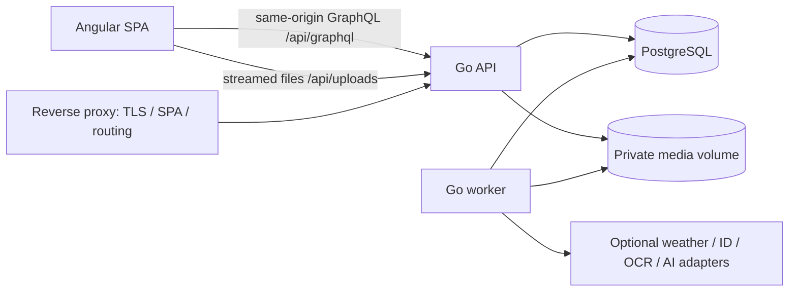

# Architecture and decisions

## System shape



One repository; two Go process commands sharing application packages; one Angular app. A worker is a deployment role of the same backend, not a separate microservice. Go handles all authorization and business rules. GraphQL is the application API; binary upload/download, auth callbacks/form endpoints, and health probes use explicit HTTP endpoints because bytes and cookies are not business graph data.

Default runtime: reverse proxy serving built SPA, API, worker, PostgreSQL, private shared media volume. Compose for local and single-host deployment; separate migration command. No Redis. No SSR for a private authenticated app. No S3 requirement. ObjectStore interface deliberately small enough for a future S3 adapter.

## Stack decisions

| Concern | Decision and boundary |
|---|---|
| Frontend | Angular 22 supported stable line at planning time; standalone components, signals, built-in template control flow, zoneless, strict TS/templates. Freeze exact compatible versions in T00. No preview APIs needed. |
| UI | Custom CSS token system plus Angular CDK accessibility/overlay primitives. No default Material skin, large component suite, or second CSS framework. Inline SVG icons from one pinned licensed set. |
| Forms | Stable Angular Reactive Forms, typed; signals for derived UI state. Do not adopt experimental form APIs for novelty. |
| Client transport | Angular HttpClient wrapper accepting generated TypedDocumentNode and typed variables/results. Page-scoped signal stores; explicit invalidation/refetch. No Apollo normalized cache or global state framework in v1. |
| API | Go current stable supported toolchain pinned by T00, stdlib net/http router, gqlgen schema-first. No ORM. |
| SQL | PostgreSQL 17 supported pinned patch line, pgx/v5, sqlc typed queries, goose ordered SQL migrations. pg_trgm only if T18 benchmarks justify it; default indexed ILIKE at this scale. |
| Async | River OSS PostgreSQL queue using pgx transaction enqueue. No Pro-only features. Durable catch-up scheduling belongs to application tables, not an assumption that periodic tick execution is durable. |
| Media | Private filesystem ObjectStore; libvips subprocess in worker for HEIC/JPEG/PNG/WebP normalization, EXIF orientation, thumbnails. Pinned runtime image with verified HEIF support; command args never a shell. |
| IDs/time | Application-generated UUIDs, timestamptz UTC instants; explicit date-only strings and IANA timezone for schedules. Inject clock and ID generator. |
| Telemetry | slog JSON logs; request/job correlation IDs; OpenTelemetry traces and HTTP metrics via configurable exporter, no mandatory hosted observability. |
| Tooling | npm lockfile, go.sum, pinned Go tools and codegen; Makefile as entrypoint, ordinary folders, no Nx/Turborepo requirement. |

T00 must compile compatibility spike for Angular/Node/TS, gqlgen/Go, pgx/sqlc/River, libvips/HEIC, Tesseract/Poppler receipt processing, and generated document execution. Record exact selected versions, image digests, licenses, and commands. If a version is unavailable, choose a supported stable compatible line and update the decision log before downstream tasks; do not use unpinned latest images.

## Repository target

```text
apps/web/src/app/
  app.config.ts, app.routes.ts
  core/{auth,graphql,errors,configuration}/
  ui/{tokens,button,dialog,field,toast,empty-state,...}/
  features/{today,collection,plant-detail,journal,purchases,care,insights,settings}/
    feature.routes.ts, pages/, components/, data-access/, *.spec.ts
server/
  cmd/{api,worker,admin,migrate}/
  internal/
    platform/{config,clock,identity,db,jobs,media,telemetry,http}/
    identity/, collection/, journal/, purchases/, care/, insights/, portability/
      model.go, service.go, ports.go, errors.go, *_test.go
    adapters/{postgres,filesystem,weather,plantnet,ocr,ai,email}/
    transport/{graphql,http}/
  db/{migrations,queries,generated}/
  graph/{generated,model}/
contracts/{graphql,operations,fixtures}/
  generated/                       # generated TS documents/types
infra/{compose,containers,proxy}/
scripts/{check-boundaries,check-task-scope,...}
tests/{e2e,fixtures,performance}/
docs/{plan,adr,runbooks}/
Makefile, .github/workflows/ci.yml
```

Use packages only when actual code needs them. Do not produce an empty scaffold for every conceivable abstraction. No generic `utils`, mega `common`, base repository, or one-interface-per-struct policy.

## Dependency direction

`transport → application/domain → consumer-owned ports ← concrete adapters`.

- Domain/application packages import stdlib and tightly scoped shared value types only; no gqlgen, generated SQL models, HTTP, or providers.
- Thin resolvers authenticate, validate transport shape, map inputs, invoke a use case, map result/errors. No direct SQL or provider calls.
- Ports describe behavior the consumer actually needs. A service can use a concrete value helper. Database adapter implements module-specific operations; avoid generic CRUD abstractions.
- Transactions live in use-case-specific adapter operations, e.g. RecordPurchaseWithAllocations or CompleteOccurrenceWithActivity, not a global untyped UnitOfWork. This keeps atomic boundaries testable without leaking pgx.
- Cross-module writes go through an explicit use-case operation; no module reaches into another module's private tables through ad hoc query strings.
- Composition roots wire dependencies. No package-global database, service locator, hidden init work, or production mocks.
- Angular pages orchestrate route and loading state; components render inputs and emit intent; data-access stores own queries/mutations. UI kit imports no feature/domain API. Features do not deep-import other features. Cross-feature navigation uses route links and shared generated contracts.
- Boundary checker verifies forbidden imports on CI; failures are architectural errors, not warning-only lint.

## Release-specific contract freeze

Freeze shared values and R1 SDL/SQL first (T01.r1/T02.r1). Care and AI boundaries in 03 are design contracts, refined and frozen in T01.care/T02.care and T01.ai/T02.ai immediately before those release lanes. Additive migrations and regenerated clients are expected and reviewed, not architectural failure. One serialized schema/codegen owner per change; no unused future-domain tables in the R1 install.

## State and concurrency

Server is authoritative. Each mutable aggregate has revision. Mutations require expectedRevision; stale writes return CONFLICT with currentRevision and no partial changes. Angular presents reload/review; it never overwrites silently. Monetary or destructive mutations use pessimistic UI; optimistic temporary states are limited to reversible UI preferences.

Every create/action mutation accepts clientMutationId. Server persists idempotency key scoped to owner + operation + key with canonical input hash and response, in the same transaction as the change. Same key/input replays result (except purged-resource responses become RESOURCE_GONE per 03 deletion matrix); different input returns IDEMPOTENCY_CONFLICT. Keep records 30 days; UI retry never generates a new key for the same user intent. Auth requests and upload streams use their own described replay policies. Queue processing is at-least-once; workers must make domain writes idempotent with unique keys, not rely solely on queue deduplication.

Do not implement event sourcing. Current-state relational records plus explicit append-only revisions/audit and an indexed journal projection are sufficient. Rebuildable timeline projection is updated in the business transaction.

## Identity/security boundary

Single owner bootstrap via `admin owner create` prompts password interactively or reads mounted secret; no password CLI argument/log. Argon2id using maintained x/crypto, calibrated parameters persisted with hashes; constant-time verification. Server-side opaque sessions (32 random bytes), store hashes; cookie HttpOnly, Secure in production, SameSite=Lax, Path=/; 12h idle, 7d absolute expiry. Rotate on login/password change and revoke all on recovery. No JWT in browser storage. Local HTTP cookie exception only in explicit development mode; production startup rejects insecure config.

Owner-only access everywhere including media/jobs/exports. All rows carry workspace_id where owner-scoped; queries explicitly filter it and relational links enforce matching workspace through composite FKs. No caller-supplied ownership is trusted. No public signup/reset email; recovery is audited local admin CLI. Rate-limit login by source plus account with bounded memory; production shared-host scale is out of scope. Generic invalid-credential messages.

Use a stable random anti-CSRF synchronizer token stored as a retrievable value in the server-side session (authentication cookie secret remains hashed), delivered via authenticated session bootstrap and sent in `X-CSRF-Token` for mutations/uploads/logout; additionally verify exact Origin for browser state-changing requests. GraphQL POST JSON only, reject batches and GET mutations. Same-origin production routing; dev proxy eliminates open CORS. CSP, no arbitrary HTML rendering, sanitize markdown to text/allowlisted links, no executable receipt previews. Secrets remain server-side. Remote provider endpoints are operator config; no user-supplied fetch URLs or model-requested network destinations.

## Reliability decisions

- Transaction + River InsertTx for media processing, analysis, email intent and exports. Scheduled tick enqueues durable unique logical work based on persisted cursors; restarts scan missed horizons.
- Domain claims determine whether a retry still applies after edit/delete. Jobs store IDs, not private file bytes or prompts.
- Provider adapters have context timeouts, bounded retries/jitter, Retry-After support, max response sizes, rate/budget caps, error taxonomy. No network transaction held open during provider calls.
- Start with one worker and conservative provider concurrency of one. Actual hardware throughput is measured before increasing local model concurrency.
- Readiness checks DB + writable media; worker liveness heartbeat and queue age monitored. Providers unavailable does not fail core API readiness.
