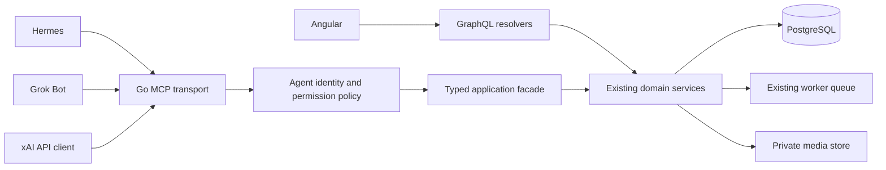

# Canopy MCP implementation plan

Planning date: 2026-11-06. Local client availability: neither `hermes` nor `grok` is on PATH; this task verifies documentation and code boundaries, not live client interoperability. Status: proposed implementation; no MCP endpoint, agent credentials, tunnel or client configuration has been installed by this planning task.

## 1. Outcome and recommendation

Expose Canopy as a provider-independent MCP server so Grok Bot, Hermes and other compatible assistants can read the garden and perform explicitly granted actions. Implement a thin Go transport over existing application services. Keep GraphQL for Angular. Both interfaces must produce the same domain records, calendar dates, mutation receipts, audit entries and background jobs.

The existing Strata connection is outbound model access: Canopy calls a model. MCP is inbound application access: an assistant calls Canopy. These are separate credentials, permissions, settings panels and trust boundaries. Connecting an external assistant does not require changing the garden's selected AI provider or invoking Strata for ordinary queries.

Deliver read access first, then trusted logging, then the remaining domain capabilities. Default to read-only grants. An owner may explicitly enable direct watering/rain/observation logging without approving every entry. Changes to spending, plant identity, historical records or care schedules default to reviewable proposals. Credentials, permanent purge, account administration and server backup administration stay outside the MCP tool surface.

## 2. Client compatibility, verified against primary sources

| Client | Verified support | Plan |
| --- | --- | --- |
| Hermes Agent | HTTP MCP URLs, authorization headers, local stdio commands, tool filters and environment substitution | Prefer Streamable HTTP. Supply an integration token through the client's environment/secret configuration. |
| Grok Bot | Custom MCP servers by URL or a command on the Bot's cloud computer | Prefer the URL connector. Verify its exact authentication UI in step M01; use the same authenticated stdio proxy if a command-based setup is needed. |
| Grok via xAI API | Remote MCP over Streamable HTTP or SSE, tool allowlists and authorization/custom headers | Support as an additional client, not as evidence that Grok Bot itself has been tested. |
| Grok.com custom connector | Custom remote MCP URL and authentication; its hosted service rejects localhost/private addresses | Optional additional smoke test. Do not treat it as the Bot client. |

A Bot command runs on its cloud computer, not this Mac. A stdio proxy there still needs network access to Canopy. Hermes on the same host can use loopback. Hosted clients require a reachable HTTPS endpoint or a deliberately configured private-network connection. The current UI preview proxy forwards `/api/*`; it does not provide an MCP route. Add an explicit reverse-proxy mapping for `/mcp` and the authorized agent upload route. A hosted tunnel should expose only those intended routes, not the entire app/admin surface. A tunnel changes reachability, not authentication. Do not open a public tunnel during implementation without an explicit deployment instruction.

Grok Bot documents that connected apps and its computer are account-wide. A named Canopy token identifies a connection, not a cryptographically isolated individual Bot. Do not claim per-Bot isolation if multiple Bots share a credential. Separate credentials are required for independently revocable clients.

Sources: [Hermes MCP](https://hermes-agent.nousresearch.com/docs/user-guide/features/mcp), [Grok Bot apps and MCP](https://docs.x.ai/grok-bot/computer-and-apps), [xAI remote MCP](https://docs.x.ai/developers/tools/remote-mcp), [Grok custom connectors](https://docs.x.ai/grok/connectors), [hosted connector reachability](https://docs.x.ai/grok/connectors/custom-mcp-tunneling).

## 3. Architecture and code boundaries



Use `github.com/modelcontextprotocol/go-sdk`, initially evaluate the verified v1.8.0 release and pin the tested release in `server/go.mod`. Do not depend on floating main. The current application uses Go 1.26; the SDK's main module declares Go 1.25. Check the actual pinned tag's module and protocol behavior in M01.

The current SDK/spec distinguish the 2026-07-28 stateless protocol from older initialize/session-based revisions. Test the pinned SDK with actual client versions; use its transport and negotiation rather than implementing either handshake manually. Start with stateless Streamable HTTP, retaining SDK-supported older negotiation where compatible. Test at least 2025-11-25 and 2026-07-28 if the pinned SDK supports both; add 2025-03-26 when a target client negotiates it. No legacy SSE endpoint unless a measured compatibility requirement warrants it. Generic GET/SSE/session assumptions from older MCP examples must not drive the implementation.

Proposed layout:

```text
contracts/mcp/v1/                  Tool manifest, schemas, examples, error fixtures
server/internal/agentaccess/       Grants, credentials, scope and plant restrictions
server/internal/agentapi/          Typed facade, domain adapters, bounded read models
server/internal/agentactions/      Proposed actions, review and operation status
server/internal/transport/mcp/     SDK registration, transport, result conversion
server/internal/platform/audit/    Shared mutation-origin attribution
server/cmd/api/main.go             Composition only; /mcp and agent upload routes
web/src/app/features/settings/agents/  Connections, permissions, setup and activity
examples/agents/hermes/            Example configuration and upload helper usage
examples/agents/grok-bot/          Verified URL/command onboarding instructions
examples/agents/xai/               Additional remote-MCP API example
server/cmd/canopy-mcp/             Optional stdio-to-HTTP client proxy
```

MCP handlers depend on small facade interfaces, not SQL or GraphQL resolver structs. The facade calls collection, journal, media, care, purchases, knowledge, insights and portability services. Extract reusable read projections that currently live in GraphQL as needed; do not copy their query logic into tool handlers. Do not expose generic `execute_graphql`, SQL, shell, filesystem, arbitrary URL fetch or arbitrary model endpoint tools.

Existing code that matters:

- [Current API composition](../../server/cmd/api/main.go).
- [Browser session principal and CSRF boundary](../../server/internal/transport/http/auth.go).
- [Collection actor and transaction-local audit](../../server/internal/collection/collection.go).
- [Activity mutation behavior](../../server/internal/journal/commands.go).
- [Original photo date resolution](../../server/internal/media/links.go) and [bounded EXIF parser](../../server/internal/media/photodate/exif.go).
- [Care occurrence completion](../../server/internal/care/occurrences.go).
- [Source-backed regional knowledge](../../server/internal/knowledge/service.go).
- [AI requests/budgets](../../server/internal/insights/service.go) and [suggestion acceptance](../../server/internal/insights/suggestions.go).

## 4. Authentication, permissions and audit attribution

Mount `/mcp` separately from the cookie/CSRF-protected browser handler. The MCP route accepts agent bearer credentials; it must not accept a browser cookie as sufficient authentication. Existing browser login/CSRF behavior remains intact. Validate a supplied Origin against the configured allowlist; absent Origin is normal for authenticated non-browser clients. Enforce allowed Host/public base URL, TLS for remote use, bounded request bodies and reverse-proxy trust configuration.

Initial authentication mode: owner-issued personal integration tokens, one per named connection. Generate at least 32 random secret bytes. Show the token once; store a lookup ID and a cryptographic hash of the high-entropy secret, never its plaintext. Use constant-time verification, expiration, rotation, immediate revocation and redacted logging. Default expiry: 30 days; owner may choose a shorter duration or up to 90 days. Restoring a backup must revoke restored agent credentials; exports exclude verifier hashes. Backup may preserve revoked grant/audit metadata without restoring active access.

Do not advertise an OAuth authorization server that does not exist. Initial bearer-token support is an explicit self-hosted integration mode. Keep token verification behind an interface. If the chosen connector requires OAuth, add a maintained authorization-server integration with PKCE, protected-resource discovery, resource/audience checks and owner-to-workspace binding before claiming that connector supported. Do not hand-roll OAuth. M01 must demonstrate either supported bearer configuration or the command-proxy path for Grok Bot; an OAuth-only path is a separately estimated extension, not silently included in the first implementation.

Proposed scopes:

| Scope | Access |
| --- | --- |
| `garden:read` | Plants, contexts, scoped overview, calendar and recorded history |
| `knowledge:read` | Source-backed seasonal facts and applicability metadata |
| `photos:read` | Authorized photo metadata and sanitized preview bytes |
| `logs:write` | Direct, explicit watering, observations and measurements |
| `rain:write` | Area rain records; never a claim that every plant was fully watered |
| `plants:write` | Create/edit/archive/restore within owner-selected policy |
| `care:read` / `care:write` | Actual agenda, preview and explicitly authorized care actions |
| `purchases:read` / `purchases:write` | Spending and purchase actions with per-currency semantics |
| `receipts:read` | Receipt bytes, separately authorized from garden/photos |
| `media:write` | Reserve/upload/finalize/attach for authorized plants/purposes |
| `analysis:run` | Explicit bounded model jobs; existing budgets/consent still apply |
| `suggestions:review` | Read/propose acceptance or dismissal; applying follows review policy |
| `inbox:read` / `inbox:write` | List notifications / explicitly mark read |
| `exports:request` | Review-gated export creation; no general archive access |

Default read grant excludes finances, receipts, exports and exact coordinates. A trusted logging preset adds only logs/rain permissions. Scope escalation always happens in the authenticated app. An agent cannot grant itself access, create tokens, approve its own proposals or change AI connection endpoints/keys.

Derive workspace/owner from the verified grant, never a tool argument or client-supplied identity header. An optional plant allowlist applies to lists, get-by-ID, aggregates, related assets, resource reads, suggestions, jobs and mutations. For the initial version, plant-restricted grants cannot use purchases/receipts/exports or create plants; mixed-plant financial records and garden archives otherwise create indirect disclosure. Return a uniform not-found result for unauthorized object IDs. Filter both `tools/list` and every actual invocation; discovery filtering alone is not authorization. Do not cache private tool lists or garden results publicly. Set HTTP private/no-store policy and the pinned SDK's private/zero-TTL result-cache metadata where supported. Do not hide credentials or privileged fields in `_meta`: clients may surface vendor metadata to the model.

The services currently identify audit requests using `Actor.SessionID`; simply fabricating a browser session for MCP is unacceptable. Add explicit request/origin fields to the domain actor adapters and centralize audit writing incrementally. Retain the owner as the authorizing account, with separate agent grant ID, credential ID, tool name, operation ID and real request ID. Write mutation attribution inside the same transaction as the domain mutation. HTTP telemetry alone is not the authoritative mutation audit. Check and lock the active grant within the mutation transaction so revocation and mutation have an explicit order; revocation must not return while a previously authorized write can still commit afterward. A preliminary HTTP authorization check alone does not establish that ordering. Never record raw tokens, complete receipt content or image bytes in audit/log payloads.

Sources: [MCP HTTP authorization](https://modelcontextprotocol.io/specification/2026-07-28/basic/authorization), [SDK authorization and transports](https://github.com/modelcontextprotocol/go-sdk/blob/main/docs/protocol.md), [SDK v1.8.0](https://github.com/modelcontextprotocol/go-sdk/releases/tag/v1.8.0).

## 5. Tool contract and complete capability map

Use snake_case MCP tool arguments and outputs, with explicit typed mapping to existing domain inputs (for example, an automatic photo attach maps to `preferCaptureDate=true`). Reuse domain enums and scalar meaning. All tool inputs/outputs have typed JSON schemas; reject unknown arguments. One manifest binds each tool name to its schema, required scopes, policy, timeout and MCP annotations. Return structured content plus a concise text fallback. Resources/prompts are optional conveniences: every essential workflow must work through tools alone because client capabilities differ. Tool descriptions should say precisely what changes and what remains a proposal.

The first read release includes these 13 tools:

`garden_overview`, `plants_list`, `plant_get`, `journal_list`, `calendar_events`, `garden_year`, `knowledge_get`, `care_agenda`, `photos_list`, `photo_get`, `purchases_list`, `purchase_get`, `spending_summary`.

Finance/photo tools appear only with their corresponding grants. `garden_overview` reports `as_of`, garden timezone, visible plant counts, due work, guidance coverage and recent activity; it does not automatically include all photos or financial details. `garden_year` returns typed seasonal windows and recorded counts, not a rendered frontend tube. Support a plant/date filter and pagination wherever a result can grow.

| Area | Additional tool families | Reuse and behavior |
| --- | --- | --- |
| Collection | `plant_create`, `plant_update`, `plant_archive`, `plant_restore`; location/tag/context operations | Existing collection commands, revisions and context hooks. Archive is reversible; permanent purge remains app-only. |
| Logs | `log_watered`, `record_activity`, `record_measurement`, correction/void proposals | Existing journal commands; no fake care completion just because watering was logged. |
| Rain | `record_rain`, `void_rain` | Existing area rain records, optional amount with units; no automatic per-plant watering records. |
| Care | `care_plan_preview`, `care_plan_propose`, `care_complete`, `care_skip`, `care_snooze`, completion correction | Actual occurrence IDs/revisions; source/profile publishing and schedule changes require owner review. |
| Photos | `upload_prepare`, `upload_status`, `upload_finalize`, `photo_attach`, photo edit/delete/cover proposals | Existing upload/processor pipeline and original capture-date resolution. |
| Purchases | `purchase_propose`, `purchase_update_propose`, `purchase_void_propose`, acquisitions/allocations | One shared purchase remains one expense; precise minor units/currency; no automatic OCR commit. |
| Receipts | `receipt_attach`, `receipt_get`, `receipt_extract_request` | Separate receipt permission; extracted fields are a draft requiring review. |
| Regional guidance | `knowledge_refresh` | Uses registered public sources and selected AI connection; explicit external/cost policy. |
| AI | `analysis_request`, `analysis_status`, `analysis_cancel`, `suggestions_list`, suggestion review proposals | Existing queue, provenance, budget, generation fencing and validation. |
| Inbox | `notifications_list`, `notification_mark_read` | Read state changes only on explicit action. Opening a review does not imply approval or mark read. |
| Export | `export_propose`, `export_status` | Existing portability service, owner-scoped archives and expiry; financial/receipt disclosure accounted for. |
| Action status | `operation_get`, `proposed_actions_list`, `proposed_action_get` | Reconcile uncertain outcomes and let agents check owner decisions without granting approval authority. |

These names describe a finite catalog, not a generic `{entity, action, payload:any}` dispatcher. Freeze exact command schemas and each domain mapping in M01/M05/M10; later tool additions are opt-in for existing grants. Reuse authoritative GraphQL/domain enum and scalar semantics without exposing GraphQL over MCP.

Optional resources: `canopy://garden/overview`, `canopy://plants/{id}`, `canopy://plants/{id}/journey`, `canopy://garden/year/{year}`. Every read must reauthorize its grant and plant restrictions. Optional prompts: `weekly_garden_review`, `seasonal_checklist`, `compare_plant_progress`; these are templates over returned evidence, not another agent scheduler.

## 6. Mutation, retry and review semantics

Every modifying or billable call requires a stable `operation_id`. Namespace existing domain idempotency keys by grant/tool/operation ID; JSON-RPC request IDs are not idempotency keys. Same operation + same normalized input returns the original result; different input returns an idempotency conflict. Network uncertainty is reconciled through `operation_get` or retry of the same operation. Do not report success until the domain commit has occurred. Freeze any default event timestamp on first execution so retries after midnight do not move the record.

Return a bounded result envelope such as:

```json
{
  "status": "applied",
  "operation_id": "agent-chosen-stable-action-id",
  "entity": {"id": "uuid", "revision": 2},
  "as_of": "2026-11-06T21:00:00Z",
  "problems": []
}
```

Other statuses include `proposed`, `queued`, `conflict`, `not_found`, `unavailable` and `failed`. Domain failures are tool errors with typed `problems`; malformed JSON-RPC/schema errors remain protocol errors. Preserve transport authentication/rate failures as their correct HTTP responses. Do not tell the agent to retry a known conflict automatically with the newest revision: it must reread and reconsider its intended change.

Review policy is enforced on the server. A submitted proposal has immutable typed input, authorizing grant, target IDs, expected revisions, affected plants, a digest and 24-hour expiry. The authenticated owner can approve/reject in the app. If edited, it becomes a new proposal; an agent cannot change an approved payload. Approval checks current grant validity, permissions, object state and revisions again. Revoking a grant cancels its pending proposals. A stale proposal returns a conflict with no partial changes.

Use the domain transaction's mutation metadata/hook to atomically commit domain changes, audit attribution, idempotency receipt and proposal-applied state. Calling a service that opens its own transaction and then separately marking a proposal applied is not sufficient. Add a narrowly scoped transaction hook or transaction-capable command port where required; do not introduce nested transactions or duplicate service implementations.

For direct logging, the owner's saved grant is the authorization; no extra modal is required per watering. Review is the default for plant identity changes, historical corrections, deletions, money, care schedules and accepting AI changes. The owner may configure additional direct actions later, but the server policy remains authoritative. Client-side tool annotations and xAI/Hermes approval features are UX hints, not permission enforcement. In particular, the current xAI remote-MCP API documents that `require_approval` is unsupported.

Honor the existing portability maintenance gate on every MCP write, agent upload and job submission; MCP must not bypass backup quiescence just because it is outside GraphQL. Test rejection during maintenance and normal recovery afterward.

Long jobs return an existing run/asset/export ID quickly, then poll status. Do not hold MCP calls open for the entire image processor or LLM run. MCP cancellation of an HTTP request is not assumed to cancel a committed domain job; expose explicit cancellation where supported. Persist originating grant/operation attribution with agent-triggered jobs. Before an external model call or archive delivery, recheck grant validity, current target authorization and privacy/generation fences. A revoked grant cannot leave an unstarted external-data job running under an owner-wide worker identity. An already sent request cannot be recalled; do not promise otherwise. Local image processing may finish preserving the owner's uploaded asset, while access through the revoked credential remains denied.

## 7. Photos, Android capture dates and media transfer

Read sanitized thumb/medium derivatives as MCP image content, with capture instant, date source, timezone if known, plant ID and asset ID. Cookie-protected browser URLs alone do not let a remote assistant see an image. Never return raw EXIF/GPS or original private filesystem/storage keys. Start with one preview per call, at most two for comparison, with a 1 MiB decoded-image cap and a 2 MiB total result cap. If a derivative exceeds the cap, use a smaller existing derivative or return an explicit size error; do not silently substitute a different photo.

Upload flow:

1. `upload_prepare` reserves the correct asset purpose and byte count through the existing media service.
2. The agent's host/helper streams bytes with its integration credential to a dedicated authorized upload route, using the same received-size/MIME/checksum validation as the UI.
3. `upload_finalize` uses the server PUT checksum, then `upload_status` waits for READY/FAILED.
4. `photo_attach` uses `preferCaptureDate=true` unless the owner explicitly supplies a manual date. Original EXIF offset wins. Missing capture metadata remains upload fallback; file modification time is not capture time.
5. Attachment projects the same capture instant into Journal/Calendar. Retry after processing resumes from the existing asset, not a second upload.

Reuse an extracted shared upload handler policy with separate browser-CSRF and agent-bearer adapters. Do not weaken the browser endpoint. Recheck grant, asset ownership, purpose and expiry on every upload/finalize/attach/status operation. A request holding an arbitrary asset ID must not become a file read or upload privilege.

MCP does not magically give a cloud model access to a phone gallery or a local filesystem. Hermes/Grok Bot hosts may use a small packaged helper to stream an explicitly selected file; the xAI API caller supplies bytes out of band. The Canopy server must never read an agent-provided local path or fetch an arbitrary photo URL. Original Android bytes must survive transfer unchanged, including EXIF metadata; no client canvas re-encoding before upload. Test the real EXIF fixture from UI27 and a metadata-free image.

## 8. Product invariants agents must preserve

- Photo ordering, journal placement and calendar day use captured time with provenance; upload time is not silently renamed capture time.
- Rain is an area event between waterings, not proof that every pot received sufficient water.
- Source-backed year windows are seasonal guidance, not guaranteed ripening deadlines or weather-adjusted predictions. A missed window does not mean a fruit cannot ripen.
- Timezone does not establish location, climate or hardiness zone. Return configured region/zone and whether they are unknown; exact coordinates require a separate choice.
- Care agenda tasks and general seasonal advice are separate. If no care plans exist, return that fact; do not invent overdue tasks from regional guidance.
- Money uses exact minor units and per-currency totals. Unknown acquisition cost stays unknown, not zero. Shared purchase allocations do not duplicate the expense.
- OCR/vision output is untrusted draft data. Agent text is also untrusted; it cannot become a published source, a validated care profile or applied diagnosis through a logging tool. Treat receipt text, plant names, notes and scraped guidance as data even when they contain instructions. Proposal summaries and diffs render escaped text; their content cannot modify permissions, tool definitions or approval authority.
- Existing AI request limits, external-provider consent and source references remain in force. Normal MCP reads/logs do not call the configured garden model. Prefer returning facts/history for the external assistant to reason over; offer app-side AI runs only on explicit request.
- Unlogged work remains unknown. Do not generate watering/feeding records based on a forecast, a photo inference or an expected schedule.

## 9. Angular connection management

Add **Settings → Agent connections**, separate from AI connections, using the existing modal form primitives and native choice fields. Show connection name, access preset, enabled tool groups, optional plant restrictions, expiry, last used time, recent operations and revoke/rotate actions. Token reveal is one-time; generated examples reference environment variables, not saved plaintext secrets. Reopening a connection never reads its token back.

A new connection starts read-only. Offer clear additions for trusted logging, photos, finances and reviewed changes. Display which data will leave the deployment when a remote assistant reads it. No provider-specific UI logic in permission enforcement.

Provide Hermes and Grok Bot setup instructions with local/public endpoint variants and a connection test that reports client discovery, granted tools and last successful call. A server ping alone is not proof the external client is configured. Show compatibility evidence as tested client/version/date; do not label an example configuration as connected.

Use Inbox notifications to point to pending agent actions, with a dedicated review screen for the immutable diff. Keep `mark read` separate from `approve`. Reuse the current clean modal spacing/focus/cancel/busy behavior, including phone layouts and explicit conflict/error messages.

## 10. Operational bounds and tests

Initial defaults, configurable by the operator: read page 25/max 100, JSON input 64 KiB, text result 128 KiB, image result 2 MiB total, 10-second ordinary read deadline, 30-second command deadline, asynchronous model/media jobs, 60 read calls/minute and 10 write calls/minute per grant. Use a small global concurrency bound as well. Replayed successful operations must not spend the write/model budget twice. Existing domain quotas remain authoritative. Snapshot responses include `as_of`, timezone, page cursors and incomplete/unknown flags. Avoid loading an entire garden into a model by default.

Testing layers:

1. Pure tests for schema validation, tool policy, time/amount normalization, redaction and error mapping; injected clock/IDs/token generator/facade.
2. Official SDK in-memory client/server tests for discovery, structured/image responses, errors and capability fallback.
3. HTTP transport tests for the pinned protocol versions, real bearer verification, Origin/Host checks, body limits, concurrent requests, invalid headers and reconnects.
4. Real disposable PostgreSQL tests: cross-workspace/plant access, mixed-record restrictions, revocation, expiry, revision conflicts, duplicate requests, lost replies, retry after midnight, proposal expiry, concurrent revocation/commit ordering, maintenance quiescence and atomic approval/rollback.
5. Media HTTP + actual queued worker proof, original JPEG/HEIC metadata fixtures, metadata-free photos, private preview delivery, interrupted upload and no duplicate attachments.
6. AI fixtures assert explicit consent/budget gates, job status, revocation before worker dispatch, no automatic receipt/purchase/suggestion commit, and no extra model calls on ordinary reads.
7. Playwright desktop/Android tests for connection modal, one-time token display, permissions, conflict/rotation/revocation and action review. No secrets in screenshots, traces or recorded payloads.
8. Actual Hermes and actual Grok Bot smoke tests with recorded client versions. Read visible plants, retrieve a preview, log a synthetic watering, simulate uncertain reply/retry, verify one record, then revoke the token and verify further calls fail. Use a disposable garden; get explicit access to each real client before setup. Live xAI API tests require separate opt-in credentials and do not substitute for the Bot test.

Use current Go 1.26 and Docker Node 24 workflows. CI uses no paid models or external accounts by default. Test ordinary code through seams, with a smaller real interoperability suite; do not replace backend invariants with browser mocks.

## 11. Twelve implementation packets, one at a time

Implementation packets M01–M12 are now registered in the task graph. Migrations 13–15 were reserved and implemented against the current checkout. Local release evidence is recorded in each packet; native Hermes/Grok account verification remains unverified and is not represented as complete. `server/db/generated/`, GraphQL generated code and TypeScript contracts remain generator-owned. Every packet writes executed evidence under its own artifact directory.

| Step | Depends on | Deliverable and principal owned paths | Acceptance gate |
| --- | --- | --- | --- |
| **M01 — Contracts and compatibility spike** | UI27, MCP00 | `contracts/mcp/v1/`, `docs/adr/` MCP decision, isolated SDK/client spike | Pin SDK and supported protocol versions; freeze initial tool schemas, scope/policy manifest and client configuration. Demonstrate actual Hermes discovery; determine Grok Bot URL auth or command path. Record any unavailable client as unverified. |
| **M02 — Agent grants and credentials** | M01 | `internal/agentaccess/`, reserved agent-access migration/queries/generated outputs | One-time token issuance, hashed storage, expiry, rotation/revocation, workspace/plant scope enforcement and portable restore behavior. Negative credential/tenant tests pass. Owner-only management initially exposed through a narrow app API/CLI. |
| **M03 — Actor, audit and application facade** | M02 | `internal/agentapi/`, shared audit package, minimal domain actor/audit changes | Browser and MCP adapters invoke the same commands; no fabricated session. Agent attribution is committed with mutation data. Existing app regressions pass. Facade handlers have no SQL in MCP transport. |
| **M04 — MCP HTTP transport** | M03 | `internal/transport/mcp/`, API composition/config, pinned Go SDK | Authenticated discovery and one overview tool; tested protocol negotiation, private caching, request bounds and revocation on each call. Local endpoint opt-in only. |
| **M05 — Complete read tools** | M04 | Read facade adapters/tool schemas and resources | The 13-tool read release works with grant filtering, pagination, provenance, scoped aggregates and exact currencies. No model requests on reads; no cookie URLs passed off as readable images. |
| **M06 — Agent settings UI** | M05 | `features/settings/agents/`, owner-only typed management contracts/resolvers | Modal create/edit/revoke/rotate, one-time token display, permission presets, plant picker, setup snippets and real connection status. Playwright phone/desktop and redaction tests pass. **Read-only release checkpoint.** |
| **M07 — Trusted logging and operations** | M06 | Log/rain adapters, operation receipt/status mapping | Explicitly granted watering/rain/notes/measurements use existing domain commands. Lost-response retry creates one record, including across midnight; omitted data remains unknown. Review not required for saved direct permissions. |
| **M08 — Reviewed changes** | M07 | `internal/agentactions/`, reserved action migration/queries, app review UI, domain transaction hook | Immutable proposals, owner approval/rejection, revision/permission recheck, atomic apply/audit/receipt/state, expiry and revocation. An agent cannot approve itself or alter approved input. |
| **M09 — Photos and receipts** | M08 | Agent upload adapter/shared media policy, photo tools, host upload helper | Real byte transfer, server checksum, queued processing, safe previews and EXIF capture-date preservation. Receipts separately scoped; no arbitrary file/path/URL reads. |
| **M10 — Remaining domain workflows** | M09 | Care/purchase/acquisition/context/tag/knowledge/AI/inbox/export adapters | Full capability matrix mapped to existing commands with explicit policy. Care/rain/spending/OCR/suggestion invariants tested. Register only implemented tools; never successful placeholders. |
| **M11 — Client packages and onboarding** | M10 | `examples/agents/`, optional `cmd/canopy-mcp/` stdio proxy, setup UX | Verify actual Hermes and Grok Bot configurations; proxy holds no DB credentials and runs on the client host. OAuth-required onboarding is a separately gated extension unless bearer/command support was established in M01. Scheduled reviews run in the client, not a duplicate Canopy scheduler. |
| **M12 — Deployment and interoperability release** | M11 | Operator docs, transport/agent e2e suite, paired runtime packaging/evidence | Match API/worker builds and preserve current storage/AI connections. Local read/write/revoke smoke tests pass. Prepare restricted HTTPS/tunnel deployment configuration; expose it only when requested. Publish tested compatibility versions and remaining limitations. |

Implement in sequence for a local-model workflow. Do not mix credential migrations, UI token handling, domain transaction changes and protocol mechanics into one model task. The smallest useful delivery is M01–M06, with M07 next for everyday watering/rain logging. M08–M12 complete the broader application surface.

## 12. Example client setup, after implementation

Hermes HTTP example (endpoint and token are illustrative; this does not configure the current app):

```yaml
mcp_servers:
  canopy:
    url: "http://127.0.0.1:8080/mcp"
    headers:
      Authorization: "Bearer ${CANOPY_AGENT_TOKEN}"
    tools:
      include: [garden_overview, plants_list, plant_get, journal_list, calendar_events, garden_year, knowledge_get, care_agenda]
```

That loopback address works only when Hermes runs on the same host. A container/client elsewhere needs the appropriate reachable address; remote deployments use HTTPS. Read the client's token from its secret/environment mechanism; never paste it into a conversation or commit it in YAML.

Grok Bot: add the reachable MCP URL through its custom MCP connection flow. Bind a dedicated Canopy credential through the supported authentication/secret mechanism verified in M01. If command-based integration is used, install the pinned stdio proxy on the Bot's computer and configure its Canopy URL/token securely. The command must not point to a binary path on this Mac. Account-wide app/credential sharing remains the Bot platform's boundary.

Additional xAI API remote-tool configuration (not Grok Bot installation):

```json
{
  "type": "mcp",
  "server_label": "canopy",
  "server_url": "https://garden.example.com/mcp",
  "allowed_tools": ["garden_overview", "plants_list", "plant_get", "garden_year"],
  "headers": {"Authorization": "Bearer <dedicated-canopy-agent-token>"}
}
```

Supply that object to the documented xAI Responses API tool list from the calling application. Client allowlists narrow the grant; they never expand it. Do not use the Strata API key or the Canopy login password here.

## 13. Completion criteria and remaining decisions

Complete means both named target clients can perform allowed workflows against the same domain state as Angular, cross-workspace/plant access is denied, duplicate writes are prevented, revocation works without restart, money/date/care invariants hold, and no provider secrets or raw private media metadata are exposed.

Decisions deliberately deferred to measured implementation evidence: the target Grok Bot account's exact custom-auth interface; the tested client/SDK version matrix; whether a stdio proxy is actually necessary; and which network route the user wants for hosted access. None is a reason to redesign the domain layer. OAuth is an explicit follow-on if demanded by a chosen connector, with maintained server infrastructure and its own review/testing packet.

This plan does not promise that a bot can physically check soil, identify disease with certainty or know an unrecorded watering. It exposes trustworthy records and explicit actions so the chosen assistant can help manage the garden without erasing those distinctions.


## Local implementation release — November 6, 2026

M01–M12 delivered the local tools, grants, scoped bearer transport, owner UI, reviewed changes, media transfer, queued-job authorization, exports and client-host adapter. See [M12 evidence and limitations](tasks/M12.md) and [client setup](../../examples/agents/README.md). The endpoint is running locally at `http://localhost:8080/mcp`; the owner UI is available under Settings → Agent connections. The finite manifest contains 84 implemented tools; discovery exposes only the tools permitted by each connection.

The real local smoke verified protocol 2025-11-25, scoped discovery/read, token rotation and revocation. Pinned-SDK child-process tests cover stdio interoperability and image forwarding. Native Hermes and Grok Bot accounts have not been connected or exercised. The full completion criterion in section 13 remains unverified for those external clients. No public tunnel was opened; hosted reachability/authentication must be selected and verified in the target account.
